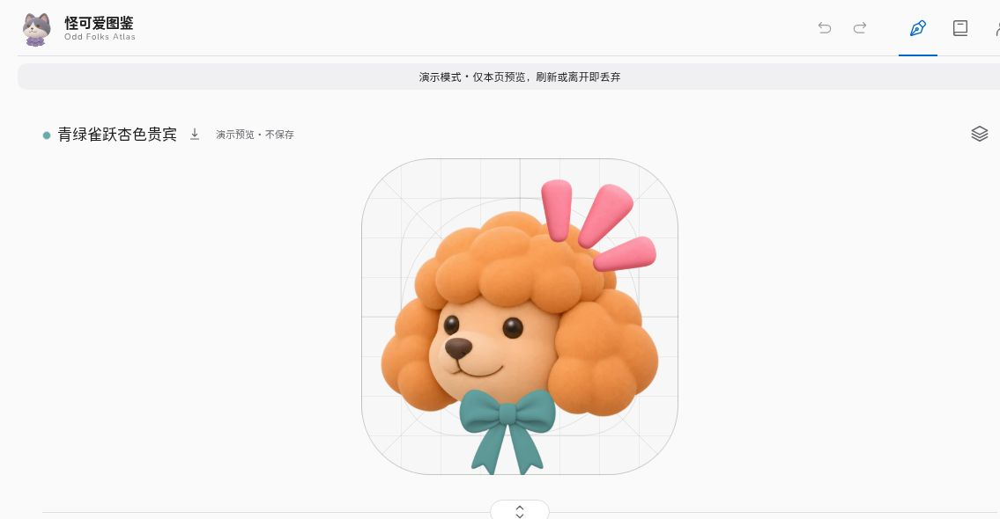
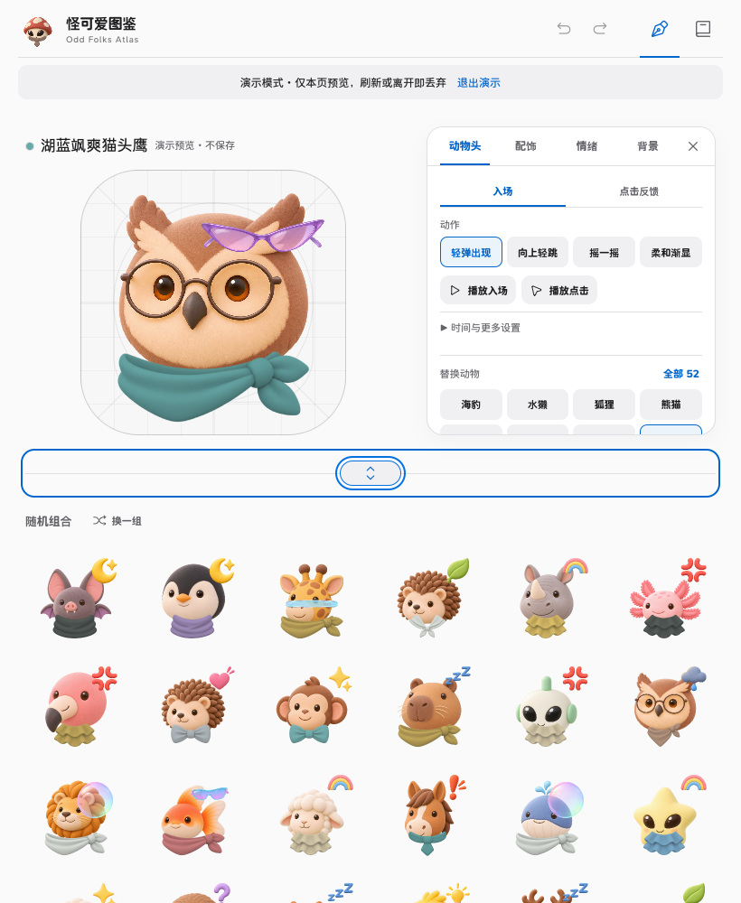

# 怪可爱图鉴 · Odd Folks Atlas

给今天的自己，挑一个怪可爱的小伙伴。

## 为什么做这个

独立产品刚起步时，即使用户还没有绑定实名或第三方账号，也值得拥有一个能代表自己的身份。怪可爱图鉴希望给匿名用户提供可选择、可辨认、有个性的头像与名字，让“一个临时访客”逐渐成为“这里的我”。

在身份之外，我们也探索收集与更换装扮的玩法，希望给用户再次回来多一点理由，增强自我认同感与留存。**这是产品设计目标，不是已经验证的留存提升结论。** 将头像绑定到真实用户、管理资产和发放奖励，需要由接入产品的用户系统实现；本仓库提供的是其中的素材编辑与配置基础。

一个可以自己部署的分层头像编辑器。把动物、奇妙角色、颜色、配饰和情绪组合在一起，调整位置，试试动效，再把喜欢的头像下载下来。

**源码公开 · 仅限许可允许的非商业用途 · 自行部署**

本项目不提供官方托管服务、SDK 或对外 API 支持。页面使用的内部 HTTP 路由是编辑器自身的实现，不承诺为第三方接入保持兼容。你部署的实例、数据、安全和升级由你自己管理。

## 看看效果

### 作者当前演示效果 · 2026-11-12



这是作者在线演示的真实截图局部，不是设计稿；只展示通用动物素材，不含用户账号信息。**线上实例与本仓库独立发行包不是同一份素材清单，也不代表下述全部线上能力开箱即用。**

### 本仓库自部署效果

以下为本仓库实际运行的浏览器截图。使用本地独立配置，无需连接作者的站点。


<details>
<summary>手机效果与资源对照表</summary>





</details>

## 素材数量与版本边界

核查日期：**2026-11-12**。数量按清单条目统计，不把不同分辨率文件重复计数。

| 范围 | 头部/角色 | 情绪/装饰图层 | 配饰 | 颜色 |
| --- | ---: | ---: | ---: | ---: |
| 本仓库独立发行包 | 52（启用 20 / 待调位 32） | 22（启用 18 / 待调位 4） | 8（启用 5 / 待调位 3） | 20 |
| 作者线上实例 | 95（启用 66 / 待调位 29） | 27（启用 26 / 待调位 1） | 8（启用 7 / 待调位 1） | 20 |

仓库数量以 [素材定义](service/avatar-identity-v3.json) 为准；线上数量仅用于说明当前创作规模，不表示这些素材均可随公开包分发。新增资源仍需单独核查授权、适配和校准，不从作者实例自动同步。各图层还受启用状态与组合规则约束，不能直接把数量相乘当作可容纳用户数或服务器容量。

作者线上图鉴默认进入不保存的 Demo，通过页脚进入正式编辑登录；浏览器里的角色模拟与真实通行证账号是两套数据，不自动合并。作者通行证中已探索的装扮资产、礼物与兑换流程，不包含在此独立仓库的账号能力里。本仓库的 Demo 与部署方式见下文。

## 可以做什么

- **组合头像**：52 个动物与通用角色头部、22 个情绪/装饰图层、8 个配饰和 20 种颜色。素材有“已启用 / 待调位”之分，数量不代表都已完成校准。
- **调整图层**：拖动、缩放、旋转、撤销和重做；同一素材的调位应用到相关组合。
- **探索组合**：随机生成一组头像、预览种子和中文名称、下载 PNG。
- **让头像动起来**：配置入场、点击、情绪强调与背景动效；尊重浏览器的减少动态效果设置。
- **整理素材**：资源对照表、颜色和名称、组合规则、受校验的 PNG 上传。上传先进入待校准状态，不会自动加入可用组合。
- **紧凑编辑面板**：名称行右侧的动效图标打开编辑菜单，展开后入口自动隐藏。动画选项排在素材替换之前，并直接在主头像中预览。手机面板滚动到边缘后继续滑动可收起，反向滑动可回到内容滚动；关闭按钮与 Escape 同样可用，数字参数保留在更多设置中。平板与桌面的并排面板随底部手柄调整高度，也可向右拖动收起。顶部右侧分组放置撤销/重做和页面切换。
- **放心试一试**：打开自己实例的 `/?demo=1`，复制当前公开配置到本页内存。调位、名称、配色和规则修改都不上传、不保存，刷新或离开即丢弃。配置了登录的实例会在服务器确认六位密码不匹配后进入此演示；正确密码仍正常登录，限速锁定与网络故障不会被当成成功。
- **一个小彩蛋**：左上角头像每次访问随机，点击或按 Enter / Space 换一个小伙伴并播放入场效果。favicon 跟随生成静态 PNG，不逐帧刷新。不同浏览器对标签栏图标更新的时机可能不同。

页面里的种子和生成标识只用于头像预览，不是账号 UID 分配系统。项目不包含第三方业务账号、用户身份库或身份迁移工具。

## 换成你的画风与资源

资源不必固定为这一套黏土动物。你可以参照现有素材的分层方式、透明背景、命名与清单格式，批量制作不同画风、不同数量的头部、情绪与配饰，再接入自己的实例。AI 可以帮助批量创作，但不能保证每张图的脸部、脖颈、装饰锚点和视觉重心都精确一致。

**编辑器的核心价值，是把这些细节留给人手动校准。** 拖动、缩放和旋转不同图层，让配饰真正落在合适的位置，再检查多种组合，而不是把未经对齐的素材直接拼起来。

建议流程：

1. **先统一素材规范**：参考现有透明素材及 [素材定义](service/avatar-identity-v3.json)，确定分层、尺寸、稳定标识与许可来源。
2. **再批量创作**：可以使用 AI 或其他绘图工具制作自己的资源；批量制作不等于编辑器已有自动批量导入功能。
3. **接入并校准**：现有 PNG 上传需通过校验，新增素材先进入待校准状态；在编辑器中手动调整位置、比例和旋转，核对名称、配色及组合关系。
4. **多组合验收后启用**：查看资源对照表和随机组合，测试不同头部、配饰和情绪的遮挡关系，确认后再启用。自行修改发行清单时同步维护版本、资产校验清单与测试。

不要直接覆盖其他实例的生产数据目录；不要把 AI 生成、可下载或公开展示等同于已获得第三方角色、商标或图片的再分发授权。

## 三步在本机运行

需要 **Node.js 22 或更新版本**。无需安装运行时 npm 依赖，也没有构建步骤。

```sh
git clone https://github.com/yanghaoleng/odd-folks-atlas.git
cd odd-folks-atlas
npm run dev
```

打开 **http://127.0.0.1:4180**。请使用这个精确地址，开发模式不接受其他 Host。

`npm run dev` 明确启用仅限本机的无密码编辑，修改会保存到自己的 `data/`。这与 `/?demo=1` 的不保存演示是两种不同模式。不要通过隧道、反向代理或端口转发把开发模式暴露出去。

## 部署自己的实例

```sh
npm start
```

默认仅在本机地址监听，**没有配置管理权限时保持只读**。只读模式仍可浏览、预览和下载。

需要远程编辑时，请按 [自部署说明](docs/SELF_HOST.md) 配置自己的 HTTPS、管理员登录和持久化目录。设置最底部提供退出登录或退出演示，方便切换模式。仓库不附默认密码，也不会读取或调用作者的部署。

请备份自己的数据；一个数据目录只运行一个服务进程。不要把 `data/`、认证文件、上传数据或备份提交到 Git，也不要把项目根目录作为公开静态目录。

## 开发与结构

```sh
npm test
```

- `dist/`：可直接运行的浏览器源码、样式、字体与素材。
- `service/`：Node.js 标准库服务，负责本实例配置、素材定义、上传校验和持久化。
- `tests/`：独立临时数据与 loopback 测试。
- `docs/SELF_HOST.md`：运行、安全配置及恢复说明。
- `docs/asset-inventory.json`：发布素材的路径、SHA-256 与许可分类。

这个独立发行版使用自己的素材清单，不能直接覆盖其他站点的数据目录。修改清单后应维护版本和对应校验，不要拿不兼容的数据强行启动。

## 使用许可

- **代码与技术文档**：[PolyForm Noncommercial 1.0.0](LICENSE)。允许目的及例外以完整许可证为准。
- **项目美术与截图**：[CC BY-NC 4.0](ASSET_LICENSE.md)，在许可人有权授予的范围内允许署名、非商业分享和改编。
- **第三方字体、图标和音效**：保留原来的 OFL、MIT、CC0 许可，见 [第三方声明](THIRD_PARTY_NOTICES.md)。

这是 **source-available（源码公开）** 项目，不是 OSI 定义的开源项目。企业内部使用、免费提供或不直接收费并不自动属于非商业用途；代码许可中明确列出的允许目的和组织例外仍按原文适用，美术许可另行判断。公开仓库不等于允许商业使用，非商业许可也不等于获得了第三方角色或商标授权。本公开包不包含已知第三方角色素材。

美术使用 AI 辅助创作；许可仅覆盖可以授予的权利，不保证生成素材在所有地区都具有排他版权。你上传或替换的素材由你负责取得相应授权。

软件按现状提供，不作可用性或适用性担保。

---

**English** · Odd Folks Atlas is a self-hosted layered avatar editor with editable transforms, random combinations, Chinese display names, PNG export and motion previews. Node.js 22+, no runtime package installation or build step. Run `npm run dev` for explicit loopback-only editing; `npm start` is read-only unless you configure your own administration. There is no official hosted service, supported SDK or public API. Code is PolyForm Noncommercial 1.0.0; project artwork is CC BY-NC 4.0 to the extent rights can be granted. Third-party components keep their original licenses.
